<html lang="ja">
    <head>
        <meta charset="utf-8" />
    </head>
    <body>
        <h1>
Glb2Ply
</h1>
        <h2>なにものか？</h2>
        

          ・Depth Anything v3 の WEBデモなど, RGB画像から奥行き推定や3D化をした結果は glbでしかダウンロードできない。 
          ・glb の点群に RGB情報が見当たらなかったため, 点群に元のRGB画像の色情報を付加してみた。 
          　(多分探せば良いツールがいくらでもありそうだけど･･･) 
          ・glb/glTF の仕様書を確認していない適当な実装。 
             
        　いまさら････ 
            　trimesh の vertext 毎に visual.vertex_colors で RGBA が格納されていた････  
            　orz 仕様書を読んでおけば･･･ 
         　python　src\simple_glb2ply.py　(glbファイル) 
             
            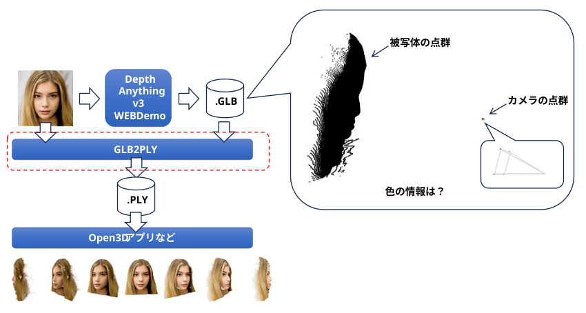
        

        <h2>環境構築方法</h2>
        

            pip install opencv-python open3d trimesh
        

        <h2>使い方</h2>
        

           ● GLBファイルにRGB情報を付加してPLYファイルとして書き出す。 
            python glb2ply.py  (RGB画像ファイル)  (glbファイル)  [(zスケール)] 
 
           ● PLYファイルの確認方法 
            python o3d_display_ply.py (plyファイル) 

　　　　　　 <table border="1">
                <tr><th>操作</th><th>機能</th></tr>
                <tr><td>左ボタン押下＋ドラッグ</td><td>3Dモデルの回転</td></tr>
                <tr><td>ホイールボタン押下＋ドラッグ</td><td>3Dモデルの移動</td></tr>
                <tr><td>ホイール回転</td><td>3Dモデルの拡大・縮小</td></tr>
                <tr><td>PrintScreenキー押下</td><td>スクリーンショット保存</td></tr>
                <tr><td>ESCキー押下 または ウィンドウ閉じるボタン押下　</td><td>プログラム終了</td></tr>
            </table>
 
            ● 点群PLYのメッシュ化 
            　python o3d_pcd_to_mesh.py (plyファイル) 
              
            ● GLBファイルにテクスチャー座標を付加してPLYファイルとして書き出す。 
            　python glb2ply_denseUV.py (RGB画像ファイル) (glbファイル)　[(zスケール)　(スキップ)] 
            　点群をドロネー分割してメッシュ化(点が多いので間引く)、テクスチャー座標付加 
              
            ● テクスチャー座標付きplyの表示 
            (環境構築) pip install PyOpenGL glfw plyfile 
            (実行)　python RgbPly.py (RGB画像ファイル)　(テクスチャー座標付きplyファイル) 
 
            ・スキップに100を指定した場合 
            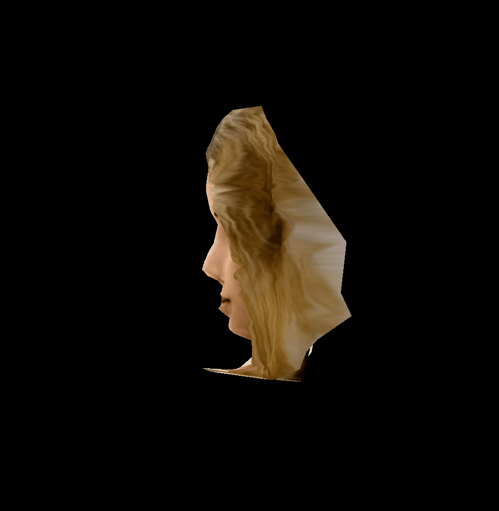 
            ・スキップに1000を指定した場合 
            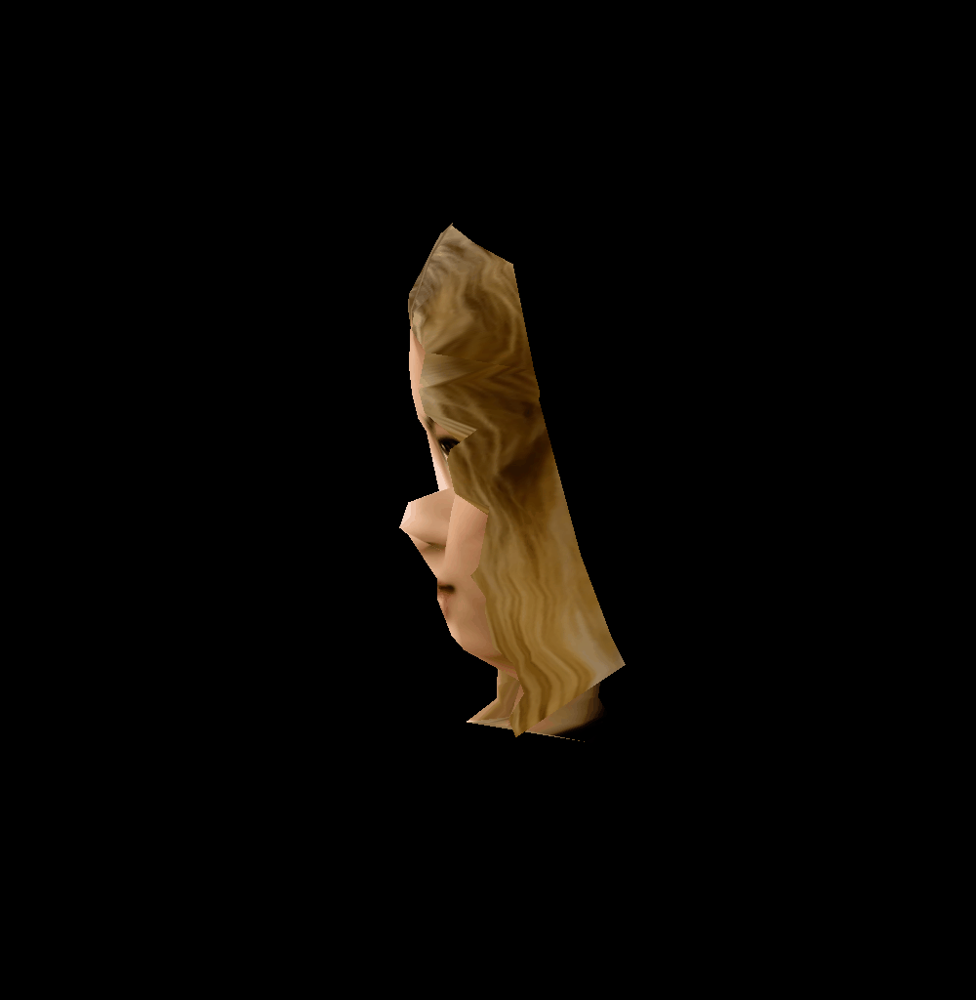 
        

        <h2>備忘録</h2>
        

        ・GLBファイルにはオブジェクトの点群とカメラの点群が格納されていた。 
        ・カメラの点群は, 16個の(x,y,z)座標。 
        ・カメラパラメータかと思ったが, それっぽい値(0や1)が全くなく、カメラの視錐体(ピラミッド)と想定。 
        ・ピラミッドの頂点なら5点で良いがなぜ16個もデータがある？ 
        ・データを見るとユニークな座標は5種類。 
        　→ ピラミッドの辺は8個  
        　→ 始点と終点で16個格納されていると想像。 
         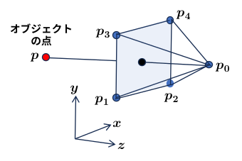 
         ・上図の配置を想定。 
         ・z 座標が一番大きい点を p0 としてオブジェクトの各点と p0 を結ぶ直線と
面 p1p2p4p3 の交点の座標のRGB画像の色を点群に付加した。 
 
         ・MVS(多視点ステレオ)の場合は複数のカメラが異なる方向を向くので, p0 と ワールド座標の z 軸方向が一致しなくなる。 
         python src\glb2ply_noRGB.py data\mvs.glb 
          
         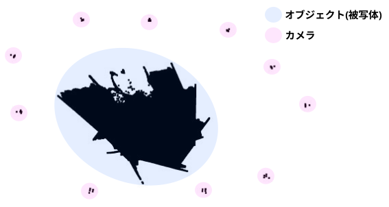 
       　まじめに p0 を抽出をしないといけない。(同一平面にある p1p2p3p4 と p0 を判別する) 
         (例) src/find_outlier_point.py

<h2>Click3R (やりたかった事はできたみたいだけど、いまいち･･･)</h2>

人のアシスト(対応点を数点クリックする)ありのMVS(Multi-View Stereo)の模様

(paper) <a href="https://arxiv.org/abs/2611.12875">https://arxiv.org/abs/2611.12875</a> 
(github) <a href="https://github.com/UVA-Computer-Vision-Lab/click3r">https://github.com/UVA-Computer-Vision-Lab/click3r</a> 
(on-line demo) <a href="https://huggingface.co/spaces/uva-cv-lab/Click3R">https://huggingface.co/spaces/uva-cv-lab/Click3R</a>

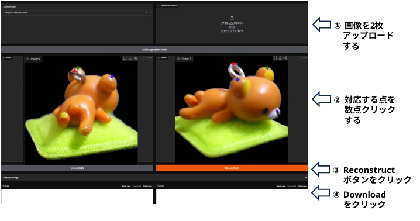

on-line demo の出力も glb だった 
またまた、仕様を確認せず、データからテキトーに点群 PLY を作成してみる。

[1] Click3R の on-line demo で出来た glb をPLYに変換する 
　・python　click3r\src\click3rglb2ply.py　 (on-line demoでできたglbファイル)
  
　　geometry_*.ply ができる。 
 
　　geometry_0: 点群 
　　geometry_1~: メッシュ 
　　・geometry_1：カメラ１の投影面？vertices:4x3, faces:4x3 
　　・geometry_2：カメラ１の視錐体？vertices:14x3, faces:48x3 
　　・geometry_3：カメラ２の投影面？vertices:4x3, faces:4x3 
　　・geometry_4：カメラ２の視錐体？vertices:14x3, faces:48x3 
　　・geometry_5～：？？？

[2] できたPLY を全部表示してみる 
　・python　click3r\src\o3d_display_plys.py　geometry*.ply 

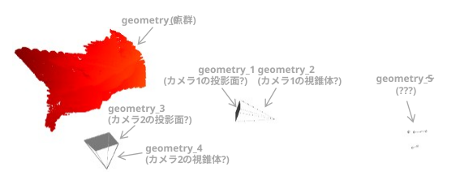

　位置関係がわかるように座標軸も表示する 
　・python　src_  click3r\src\o3d_display_ply2.py 
　　geometry_0.ply　geometry_1.ply　geometry_2.ply 
　　geometry_3.ply　geometry_4.ply　click3r\data\axisXYZ.ply 
 
　※ 色情報の無い点群はOpen3D Visualizerが色を付ける 
　　　1押下：z値(デフォルト)、2押下：x値、3押下：y値、･･･ 

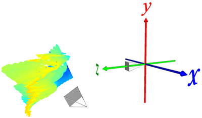

　投影面：geometry_1,　geometry_3 
 
　　vertices:　頂点の4点 
　　faces： 三角形分割した2枚×(裏表：2)＝4枚

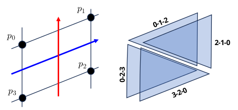

　視錐体：geometry_2,　geometry_4 
 
　　vertices:　ピラミッドの頂点(5点)＋表示用に太らせるための点(9点)と憶測･･･ 
　　最初の5点の内、同一平面内にない点をカメラ中心と想定 

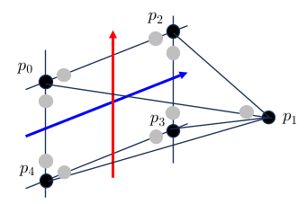

　・投影面の頂点は geometry_1,　geometry_3 から取得 
　・カメラ中心は geometry_2,　geometry_4 から取得 
　・点群内の点と、カメラ中心を結ぶ直線が投影面と交わる点を求め 
　　その座標のマスクが閾値以上なら、画像の色を点群内の点に割り当てる 
　　処理を複数のカメラで実施する 

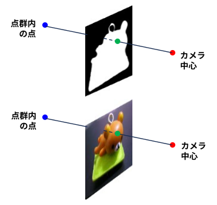

　[3] GLB→PLY 
 
　引数が多いので、config ファイルを指定することにした。 
　python　click3r\src\glb2ply.py　(configファイル) 
 
　～configファイル～ 
 
　　[PLYS] 
　　point_cloud:　(geometry_0 を格納したPLYファイル) 
 
　　frame1:　(geometry_1 を格納したPLYファイル) 
　　pyramid1:　(geometry_2 を格納したPLYファイル) 
 
　　frame2:　(geometry_3 を格納したPLYファイル) 
　　pyramid2:　(geometry_4 を格納したPLYファイル) 
 
　　[IMAGES] 
　　image1:　(画像1) 
　　image1_mask:　(画像1のマスク) 
 
　　image2: 　(画像2) 
　　image2_mask:　(画像2のマスク) 
 
　～変換したPLYの表示例～ 
　　　いまいち･･･

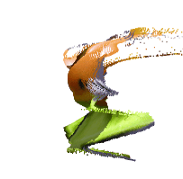

</body>
</html>
